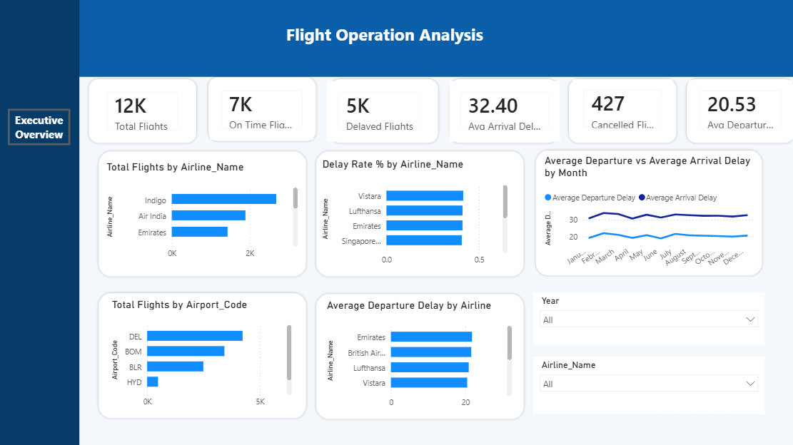
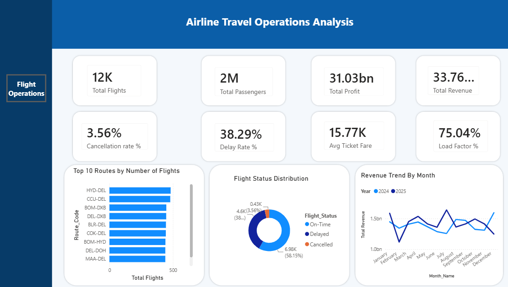

# ✈️ Airline Travel Operations Analysis

An interactive Power BI data analytics project exploring airlineoperations, passenger volume, flight delays and cancellations, routeactivity, revenue, and aircraft utilization.

## 🎯 Project Aim
To analyze airline flight operations, passenger trends, delays, cancellations, airline and airport performance, route activity, monthly revenue, and aircraft load factor using Power BI, in order to identify operational patterns and provide data-driven insights for performance monitoring and planning.

## 📊 Key Metrics
| Metric | Value |
|---|---|
| Total Flights| 12K |
| Total Profit  | 31.03bn |
| Total Revenue | 33.76bn |
| Cancellation Rate | 3.56%  |
| Delay Rate  | 38.29% |
| Average Ticket Fare  | 15.77K |
| Load Factor | 75.04% |

## 🗂️ Repository Contents
| File | Description |
|---|---|
| `Uncleaned_Flight_Dataset.xlsx` | Raw source dataset |
| `Flight_Cleaned.pbix` | Cleaned, analysis-ready dataset |
| `Flight_Dashboard_2.png` | Executive Overview dashboard preview |
| `Flight_Dashboard_1.png` | Flight Operations dashboard preview |
| `Conceptual_datamodel_Flight.png` |  Conceptual data model diagram
| `Physical_datamodel_Flight.png` |  Physical data model diagram
| `PROJECT_DOCUMENTATION.md` | Detailed project documentation,including aim, dataset description,cleaning process, results,outcomes, and insights 

## 🛠️ Tools Used
Microsoft Power BI --- report building and data visualization
Power Query --- data inspection, cleaning, and transformation
Microsoft Excel --- source dataset review

## 🔍 What the Dashboard Answers
- How many flights and passengers are represented in the dataset?
- What are the total revenue and profit shown by the report?
- What are the flight cancellation and delay rates?
- Which routes have the highest number of flights?
- How are flights distributed across on-time, delayed, and cancelled statuses?
- How does monthly revenue compare between 2024 and 2025?
- Which airlines operate the most flights?
- How does the delay rate vary by airline?
- How do average departure and arrival delays change by month?
- Which origin airports handle the most departing flights?
- Which destination airports receive the most incoming flights?
- How does average departure delay compare across airlines?
- How do the results change when filtering by year or airline?

## 📈 Highlights
- Built an interactive, multi-page Power BI report with a consistent
blue-and-white visual theme.
- Organized the dataset into a central flight fact table and
dimensions for date, airline, origin airport, destination airport,
aircraft, passenger, and route.
- Used KPI cards, bar charts, a donut chart, and monthly line charts
to communicate operational and financial measures.
- Added Year and Airline slicers to explore the report by period and
carrier.
- Reviewed data quality and identified a consistency issue where some
cancelled flights are also marked with Delay_Flag = 1; the
delay-rate calculation should exclude cancelled flights.

See **[PROJECT_DOCUMENTATION.docx](PROJECT_DOCUMENTATION.docx)** for the full breakdown of the cleaning process, methodology, and detailed insights.

